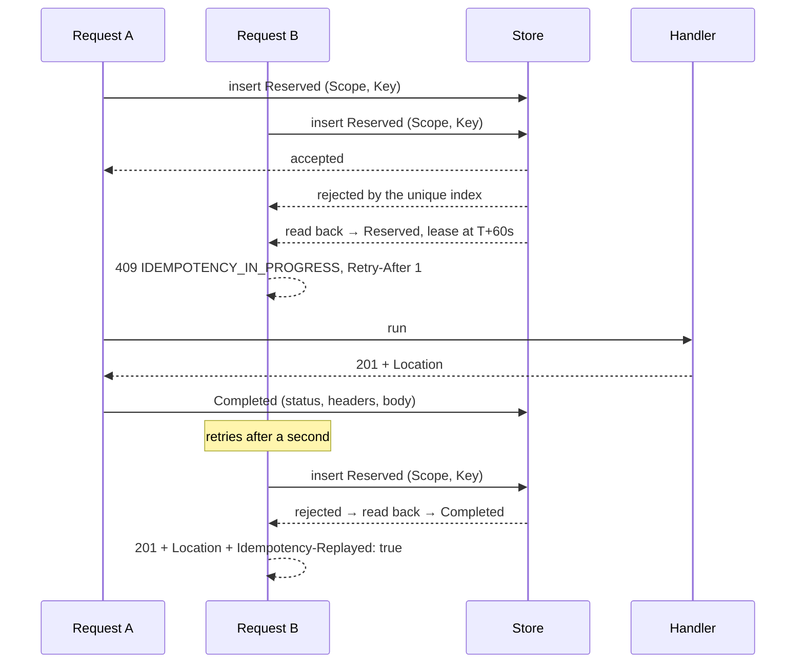

# Idempotency

A client sends `Idempotency-Key: <uuid>` on an unsafe request. If that request arrives twice — a
double-clicked submit button, a mobile client retrying a call that actually succeeded on a
connection that died before the response came back, an `HttpClient` retry policy layered onto a call
that turns out not to be safe to retry — the second one is answered with the response the first one
produced, and nothing runs a second time.

## The fourth edge

[Rule 5](architecture-rules.md) says at-least-once means idempotent, and the framework already made
that true on three of the four edges a duplicate can arrive on. This page is the fourth.

| Edge | What deduplicates it | Where |
| --- | --- | --- |
| An integration event in | `IInboxStore.TryBeginAsync` and the unique index on `(Consumer, EventId)` | `Bsft.Messaging` / `.EfCore` |
| Somebody else's webhook in | `IInboundWebhookDeduplicator`, keyed `(ConsumerId, MessageId)` | `Bsft.Webhooks` / `.EfCore` |
| Our webhook out | the `idempotency-key` header on every delivery, and a redelivery reusing its `webhook-id` | `Bsft.Webhooks` |
| **A client's `POST` in** | **`Bsft.Idempotency`** | this page |

It is the edge with the highest duplicate rate in practice, and the one where a duplicate is two
orders, two invoices or two charges rather than a wasted round trip.

It is also the half of a pair. `Bsft.Http` answers "did somebody else change this since I read it"
with `ETag` and `If-Match`; this answers "is this the same request I already ran". Both belong on an
unsafe endpoint, and [crud-conventions.md](crud-conventions.md#idempotency-on-unsafe-endpoints)
states which endpoints need which.

## Wiring it

```csharp
builder.Services.AddBsftIdempotency(builder.Configuration);
builder.Services.AddBsftIdempotencyEFCore<AppDbContext>();   // more than one replica

app.UseBsftDefaults();      // BsftExceptionMiddleware is in here
app.UseRouting();
app.UseAuthentication();
app.UseAuthorization();
app.UseBsftIdempotency();   // after all three, and the order is load-bearing
```

Three ordering rules, each of which fails silently rather than loudly if it is broken, which is why
a test asserts them rather than this paragraph:

- **After `UseRouting()`**, because the opt-in is endpoint metadata and there is no endpoint before
  routing has run. Placed earlier the middleware sees no metadata, protects nothing, and looks
  exactly like a host whose endpoints were never marked.
- **After authentication**, because the authenticated subject is part of the fingerprint *and* of
  the store key. Placed earlier every caller shares one scope, which is a cross-tenant replay.
- **After `UseBsftDefaults()`**, so `BsftExceptionMiddleware` is outside it and the 428 and the two
  409s reach the client as `application/problem+json` rather than as a 500.

Then opt endpoints in, either way:

```csharp
[HttpPost]
[Idempotent]
public async Task<ActionResult<CreatedResponse>> Create(CreateProductRequest request) { … }
```

```csharp
var group = app.MapGroup("/api/payments").RequireIdempotencyKey();   // and refuse a call without a key
```

## What a client sees

| Situation | Result |
| --- | --- |
| First request | Runs. The response is stored. |
| Repeat, same request | The stored response, plus `Idempotency-Replayed: true` |
| Key absent where required | **428**, `errorCode` `IDEMPOTENCY_KEY_REQUIRED` |
| Key reused with a different request | **409**, `errorCode` `IDEMPOTENCY_KEY_REUSED` |
| Key still in flight | **409** with `Retry-After`, `errorCode` `IDEMPOTENCY_IN_PROGRESS` |
| Key malformed or too long | **400**, keyed on `idempotencyKey` |
| Body over `MaxBodyBytes` | **413**, `errorCode` `IDEMPOTENCY_PAYLOAD_TOO_LARGE` |
| Response over `MaxResponseBytes` | answered normally, but not stored — the key runs again |

The in-progress case is the one hand-rolled implementations get wrong. They either block — holding a
connection and a database row for the duration of somebody else's request — or answer 200 with no
body, which a client cannot tell from success. A 409 with `Retry-After` is honest, and the client's
existing retry policy already knows what to do with it.

The `Retry-After` is `InProgressRetryAfter` (one second by default) capped by what is left of the
lease and floored at a second. It is deliberately not derived from `InProgressTimeout`: a minute is
the right ceiling for abandoning a crashed request and the wrong thing to tell a client waiting on a
handler that takes 200 ms.

## The state machine

`Reserved → (Completed | Failed | Abandoned)`, and only the first two are values of
`IdempotencyRecordState`, which is worth saying plainly.

- **Reserved** is written *before* the endpoint runs. The conditional insert is what settles the
  race — a unique index on `(Scope, Key)` in the shared store, an atomic add in the in-process one —
  because a read followed by a write lets two concurrent requests both find nothing and both
  proceed. The index *is* the deduplication, not an optimisation of it.
- **Completed** stores the status, the allowlisted headers and the body. Both a `2xx` and a `4xx`
  the endpoint wrote are stored: a request refused for a business reason will be refused again, and
  replaying the refusal is cheaper and more truthful than re-running it.
- **Failed is not a stored state.** A `5xx`, and any status listed in `NonReplayableStatusCodes`
  (401, 403, 408 and 429 by default), releases the record so the client may genuinely retry — which
  is the whole point of the header. Those four are excluded because the caller may have fixed its
  token, been granted the permission, or simply waited, and replaying the old refusal would lock it
  out of a request that would now succeed. `5xx` is not configurable.
- **Abandoned is not a stored state either.** It is what a `Reserved` record past its
  `InProgressTimeout` is called, computed from the lease rather than written by anybody — because
  the process that would have written it is usually the process that crashed. The next request under
  that key reclaims the record and runs. A live process arrives at the same state when its store
  write fails: the response goes out before the record is written, deliberately, because the work the
  endpoint did is done either way and a store that has become unreachable should cost the deployment
  a remembered response rather than cost the client one it has already earned. The reservation then
  stands until its lease runs out and is reclaimed the same way.
- **Retention** (24 hours by default) bounds the replay window, and it is a contract rather than an
  implementation detail: after it, the same key runs again. `IdempotencyRecordSweeper` sweeps expired
  rows in set-based deletes on a cadence of the retention, capped at an hour, and bounded at 500 rows
  a statement. A pass that fills its batch sweeps again straight away rather than waiting for the next
  interval, so a backlog is cleared in one sitting while no single delete holds locks against a table
  that is taking an insert for every live request. The sweep is one
  predicate — the record's own expiry against now — which is what makes it safe: a reservation still
  inside its lease is not expired and is therefore never pruned. The delete carries that predicate a
  second time, because the batch is read in one statement and deleted in the next: a request
  reclaiming a lapsed key in that window writes a lease in the future onto a row the sweep has already
  picked, and deleting it by its id alone would free a key a request is using.

### The concurrent race, end to end

Two requests carrying the same key arrive at the same moment. The database decides, and it decides
once.



The two things that make it work are both in the middle: the insert is the arbiter rather than a
preceding read, and the loser reads the standing record back instead of failing. Everything else —
the wait, the retry, the replay — follows from those two.

### The one thing that is not cached

A response the endpoint *wrote* is stored. A response produced by **throwing** is not: the
middleware sits inside `BsftExceptionMiddleware`, so a `ValidationException` or a
`BusinessRuleException` is mapped to its problem document outside this middleware, after the record
has already been released. The same key therefore runs again.

This is stated rather than glossed because it is the one place the design and the ideal diverge. It
costs nothing in practice — the failures the CRUD conventions throw are decided from the request and
the current state, so re-running one produces the same refusal — and the alternative is to put the
middleware outside the exception middleware, which would make its own 428 and 409 unmappable. The
guarantee that matters is unaffected: a request that had a side effect is never run twice.

## Fingerprinting

A key alone is not enough. A client that reuses a key for a *different* body must be told, not
quietly served somebody else's answer. So a record stores a fingerprint, built with `Bsft.Http`'s
[`CanonicalHash`](http.md#the-tag) over an explicit, length-prefixed sequence:

1. the method
2. the **matched route pattern**, not the raw path, so `/api/orders/{id}` is stable
3. the sorted query string, framed by its own count
4. the tenant from `ITenantContext`
5. the authenticated subject
6. the API-key or client id, where there is one
7. the content type
8. the SHA-256 of the request body

The sequence is written out here rather than derived from a serializer for the reason `CanonicalHash`
exists at all: a digest over a serializer's output moves when property order or number formatting
moves, and two replicas would then disagree about whether a request is the same request.

`IIdempotencyFingerprintContributor` lets a host adjust the sequence. It takes the sequence and
returns one, so a segment can be removed as well as added — and the ordering rule is the caller's to
keep: append or replace in place, because inserting a segment in the middle changes every
fingerprint already stored.

**The API version is not a segment of its own.** `Bsft.Hosting`'s versioning defaults use
`UrlSegmentApiVersionReader`, so the version is part of the matched route pattern, which is already
segment 2. A host that switches to a header or media-type reader adds it through a contributor.

### The cross-tenant boundary

Segments 4, 5 and 6 are also hashed on their own into the **scope**, which leads the store's key. One
tenant guessing another's key exactly still lands in a different scope, so it is a miss and the
request runs — it is never a replay of somebody else's response. That is the security property this
design rests on, and it is asserted by a test rather than argued for here.

**An anonymous caller is named by its connection.** Three absent segments are the same three absent
segments for everybody, so on an endpoint that is both `[Idempotent]` and anonymous, two callers
presenting one key for one request would share a scope and the second would be handed the first
one's stored response. Where there is no subject and no credential, the connection's remote address
takes the subject's place — it is the only identity such a request has, and it is read from
`HttpContext.Connection` rather than from a forwarded header, so a caller cannot choose whose scope
it lands in. The cost is stated rather than hidden: an anonymous client whose address changes
between the attempt and the retry gets a miss, and its request runs again. An endpoint where that
matters wants an authenticated caller, not a wider scope.

**A caller that is an API key names itself by the key.** Segment 6 reads the OAuth `client_id` claim
first and, where there is none, the canonical API-key claim `bsft:api-key` that
`Bsft.Auth`'s API-key authentication writes (`BsftClaimsMappingOptions.CanonicalApiKeyClaimType` is
the source of truth; `Bsft.Idempotency` mirrors the literal rather than referencing the
authentication stack). Such a principal carries no subject at all, so without the key id two service
credentials of one tenant behind one egress address would fall back to the same remote scope — and on
a machine route like `Bsft.Billing`'s usage reporting the second key's report would be answered with
the first key's stored 202 while its usage was never recorded. Key ids are prefixed `api-key:` and
client ids `client:`, so a key whose id reads like a client id is still a different caller.

Inside the scope, "no tenant was resolved" and "the tenant whose id is blank" are different facts and
are kept different: `CanonicalHash` encodes a null segment differently from an empty one, so the two
cannot collapse into each other. The digest is what the store and the audit trail hold, so an audit
of key activity is not a second place every caller's identity is written down.

### Buffering the body and the response, and their bounds

Hashing the body means reading it, so it is read through `Request.EnableBuffering()` and rewound —
the endpoint then binds its model normally. The cost is bounded by `MaxBodyBytes` (1 MiB), and a
request above it is **refused with a 413** rather than let through. That direction is deliberate:
letting it through looks exactly like success and leaves the endpoint unprotected until the duplicate
arrives.

The response is buffered whole too, because a response that has already gone out cannot be stored.
That side has its own bound, `MaxResponseBytes` (1 MiB), and it fails in the other direction: the
response is sent to the client normally and simply not stored, and the reservation is released so
the key runs again. Refusing it would throw away work the endpoint has already done and the client
is entitled to; the bound exists so that one caller cannot grow the record table without limit by
repeatedly asking for a large answer.

Endpoints that stream are therefore not candidates. A file upload through `IScannedFileIngestor`, a
download, a server-sent-event stream: none of them should be marked `[Idempotent]`, because both
directions are held in memory for the length of the request. An upload's idempotency is its own
problem and belongs to its own ticket.

## The two modes, and what each buys

The reservation and the endpoint's own transaction are not one atomic unit unless the host makes them
so. Both answers ship, and the difference is a guarantee rather than a preference.

| | `Detached` (default) | `Enlisted` |
| --- | --- | --- |
| When the reservation commits | immediately, before the endpoint runs | with the endpoint's own `SaveChanges` |
| Visible to a concurrent request | at once | at commit |
| Needs a `DbContext` | no — works with any store | yes, `Bsft.Idempotency.EFCore` |
| Concurrent duplicate is refused by | the 409 this middleware writes | the unique index, as a `DbUpdateException` in the handler's save |
| A crash between reservation and commit leaves | a reserved key with no business row | nothing; the two are one outcome |
| Recovery from that | the lease lapses after `InProgressTimeout`, then the key runs | not needed |

`Detached` is the default because forcing enlistment forces a `DbContext` dependency on hosts that
only want the double-click fixed, and `Bsft.Idempotency` has no EF Core reference at all. Its
limitation is real and is named rather than hidden: for at most `InProgressTimeout` after a crash, a
client is told to wait for work that will never finish.

Three footnotes on `Enlisted`, each of which follows from what it is rather than from how it is
implemented. A handler that never calls `SaveChanges` stores no record, because there is no commit to
ride. A *reclaim* — taking over a record whose lease lapsed — is written immediately whatever the
mode, because a reservation that were only staged would leave the lapsed one standing and the crashed
request's key blocked. And the *completion* is written immediately once the handler's own save has
already committed the reservation, which under the CRUD conventions is the ordinary case: the
atomicity `Enlisted` buys is the atomicity of the reservation with the business row, and by the time
the response exists that window has closed.

`Detached` writes through the application's own context, so it commits what is pending in that unit
of work at the two moments it writes. At both of them — before the endpoint runs, and after it has
answered — the endpoint has nothing uncommitted under the CRUD conventions, where a handler saves
before it returns.

## More than one replica

The default store remembers keys in the memory of one process. Two replicas have two memories, so a
retry that lands on the other one runs: the in-process default multiplies the duplicate window by the
number of instances, exactly as the in-process webhook deduplicator does.

`Bsft.Idempotency.EFCore` closes it. Implement `IIdempotencyDbContext` on the application's context,
apply `IdempotencyRecordEntityConfiguration` — which is what puts the unique index there — and
register the store; it replaces the in-memory one rather than adding to it, so the order of the two
lines does not matter.

The index is unfiltered on purpose. A filtered unique index is the right shape where a settled row
must stop competing for its name, as it does for `JobRunEntityConfiguration`; here the uniqueness has
to hold for a reserved row and a completed one alike, because a completed record is exactly what a
replay is looked up by. There is therefore no provider-specific predicate to supply and no
constructor argument to supply it through.

## Observing it

`bsft.idempotency.replayed`, `.conflicted` and `.in_progress` are published on the `Bsft.Idempotency`
meter, which `AddBsftIdempotency` advertises through `Bsft.Instrumentation` so an observability
backend collects it without referencing this package.

The same three decisions go to `IIdempotencyAuditSink`, whose default discards them. A key-reuse
conflict is the one worth watching: it is either a client minting keys wrongly, or somebody probing
another caller's keys. A request that simply ran is not reported — it is the ordinary case, and
auditing it would double the write volume of every protected endpoint for no signal.

## Not in here

- **`GET`, `PUT` and `DELETE`.** Idempotent by construction under the CRUD conventions: a `PUT`
  replaces the editable state of a named resource and a `DELETE` removes it, so a key changes
  nothing. Sending one is harmless and is simply ignored, because `Methods` is `POST` alone.
- **Response caching.** This is not a cache. A replay is deliberately *not* served to a different
  caller, which is the opposite of what a cache is for.
- **A distributed lock.** The unique index is the coordination. Adding Redis would add a failure mode
  without adding a guarantee.
- **Retro-fitting keys onto the framework's own endpoint families.** `MapBsftWebhooks`,
  `MapBsftApiKeys` and the rest each have their own route inventory, and each is its own follow-up.
- **Client-side key generation helpers.** A `Guid.NewGuid()` per logical operation, kept across
  retries of that operation, is the whole recipe.
